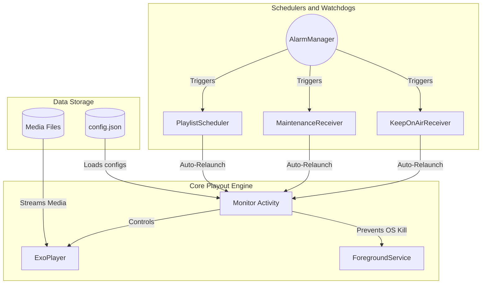

<div align="center">
  

  # Telefyna

  **24/7 unattended TV playout for Android TV boxes: scheduled local files and live streams, with graphics, fallbacks and self-healing.**

  [](https://github.com/AvventoMedia/Telefyna-Kotlin-Application/actions/workflows/android-tests.yml)
  [](LICENSE)
  [](LICENSING.md)
</div>

---

## Contents
- [Overview](#overview)
- [Quick start](#quick-start)
- [Folder layout](#folder-layout)
- [Configuration](#configuration)
- [Remote management](#remote-management)
- [Reports](#reports)
- [Resilience & monitoring](#resilience--monitoring)
- [Architecture](#architecture)
- [Development](#development)
- [Roadmap](#roadmap)
- [Changelog](#changelog)
- [License](#license)

---

## Overview

Telefyna turns an Android TV box into an automated broadcast playout. It plays local folders and online streams (HLS, DASH, RTSP, RTMP, SRT) on a schedule defined in `config.json`, overlays station graphics (logo, live/repeat watermarks, lower thirds, news ticker with clock), and keeps the channel on air without anyone at the box.

> [!IMPORTANT]
> **Built for 24/7 operation.** A foreground service, keep-screen-on, and self-rescheduling `AlarmManager` watchdogs keep Telefyna running and bring it back after crashes or OS kills. Every event is written to a daily audit log.

**Highlights**
- Time-slot scheduling by weekday or date, with a default playlist and an offline/filler fallback
- Local playlist modes: sequenced, randomized, and four resuming modes that pick up where they left off
- Intro and outro bumpers (general, special, and per-playlist)
- Fade-in transitions, logo and watermark graphics (GIF supported), lower thirds, scrolling ticker with clock
- Automatic fallback to fillers when the internet drops, and back when it returns
- Email alerts, audit logs, and OS kill-reason forensics (Android 11+)

---

## Quick start

1. **Install** the APK on the Android TV box (`adb install telefyna.apk`).
2. **Grant permissions.**
   - On phones and tablets: accept the *All files access* and *Display over other apps* prompts.
   - On Android TV / Google TV (no settings screens for them):
     ```bash
     adb shell appops set org.avventomedia.app.telefyna MANAGE_EXTERNAL_STORAGE allow
     adb shell appops set org.avventomedia.app.telefyna SYSTEM_ALERT_WINDOW allow
     ```
   - *Display over other apps* lets the watchdog bring Telefyna back after a crash; Android 10+ otherwise sometimes blocks the relaunch.
   - On a box used only for playout you can also make Telefyna the home app, so Android itself keeps it in front: `adb shell pm enable org.avventomedia.app.telefyna/.HomeLauncher`.
3. **Create your configuration** with the [online configuration tool](https://avventomedia.org/telefynaConfiguration/) and save it as `config.json`. *Or skip it:* on first run without a `config.json`, Telefyna installs a default one (a `Default` and a `Fillers` playlist) and creates the folder layout below. Just copy videos into `playlist/default` and `playlist/fillers` and it starts playing.
4. **Copy content** to a `telefyna` folder at the root of internal storage or the SD card (see [Folder layout](#folder-layout)).
5. **Launch Telefyna** from the TV home screen (*Your apps*). It loads the config, schedules the day, and starts the current slot.

> [!NOTE]
> Scheduling follows the device clock. Set the correct date, time and timezone, and enable network time, especially on boxes without a real-time-clock battery.

---

## Folder layout

```text
telefyna/
├── config.json              # schedule and settings (from the configuration tool)
├── logo.png                 # station logo (png | jpg | webp | gif)
├── slate.png                # optional "We'll be right back" artwork (png | jpg | webp | gif); built-in card otherwise
├── playlist/
│   ├── sermons/             # one folder per playlist (urlOrFolder); subfolders allowed
│   └── fillers/
├── bumper/
│   ├── General-INTRO/       # played before every non-resuming local playlist (if enabled)
│   ├── General-OUTRO/
│   ├── <special>-INTRO/     # shared by playlists with specialBumperFolder = <special>
│   ├── <special>-OUTRO/
│   ├── <playlist folder>-INTRO/
│   └── <playlist folder>-OUTRO/
├── lowerThird/              # lower-third clips referenced by graphics.lowerThirds[].file
└── watermark/
    ├── live.png             # "LIVE" logo (displayLiveLogo)
    └── repeat.png           # "REPEAT" watermark (displayRepeatWatermark)
```

Audit logs and control files are kept together in **`telefynaAudit/` at the root of storage**, where FTP, Syncthing and file managers can reach them. On Android 11+ this needs *All files access* (see Quick start); without it, Telefyna falls back to `Android/data/org.avventomedia.app.telefyna/files/telefynaAudit/`. Control files dropped in that older location are still honoured.

---

## Configuration

`config.json` is generated by the configuration tool. Its main fields:

| Field | Meaning |
|---|---|
| `name`, `version` | Station name and your own config version |
| `wait` | Seconds between watchdog checks, and how long to wait for internet (default 30) |
| `auditRetentionDays` | Days of daily audit logs to keep (default 60; `0` keeps everything) |
| `loudnessLeveling` | `true` levels loudness between programmes, bumpers and streams (default `false`) |
| `loudnessTargetDbfs` | Target programme level in dBFS RMS when levelling (default `-20`) |
| `automationDisabled` | `true` plays only the first playlist, with no schedule |
| `notificationsDisabled` | Hide the playback notification |
| `alerts` | Email alerts: `mailer` (SMTP) and `subscribers` (emails, event category, attachments; `attachReports: true` also emails each new PDF report) |
| `playlists[]` | The playlists; see below |
| `schedules[]` | Time slots that reuse a playlist (`playlistId`) with their own `start`, `days`, `dates`, `graphics`, … When two slots start at the same time, one booked for **today's date** (a special event) always wins over a weekly/daily one; otherwise the one later in the list wins |

**Playlists.** The **first** playlist is the default: it plays whenever nothing else is scheduled. The **second** is the filler/offline fallback: it plays when an online stream fails or a finite playlist finishes early. Keep both active.

| Playlist field | Meaning |
|---|---|
| `type` | `ONLINE`, `LOCAL_SEQUENCED`, `LOCAL_RANDOMIZED`, `LOCAL_RANDOMIZED_ONE`, `LOCAL_RESUMING`, `LOCAL_RESUMING_SAME`, `LOCAL_RESUMING_NEXT`, `LOCAL_RESUMING_ONE` |
| `urlOrFolder` | Stream URL, or folder name(s) under `playlist/` (comma-separated) |
| `start` | Slot start time, `HH:mm` |
| `days` / `dates` | Weekdays `1-7` (Sun–Sat) and/or dates `dd-MM-yyyy`; neither = daily |
| `usingExternalStorage` | Read from USB / SD instead of internal storage |
| `playingGeneralBumpers`, `specialBumperFolder` | Bumper selection (non-resuming local playlists) |
| `emptyReplacer` | Index of the playlist to play if this one is empty |
| `repeat` | For resuming playlists: `DAILY`, `WEEKLY`, `MONTHLY`, `QUARTERLY`, `ANNUALLY` |
| `graphics` | `displayLogo`, `logoPosition` (`TOP`/`BOTTOM`), `displayLiveLogo`, `displayRepeatWatermark`, `news` (`messages` separated by `~~`, `startMinute`, `showTime`), `lowerThirds[]` (`file`, `starts` in minutes, `replays`) |

**Random modes:**
- `LOCAL_RANDOMIZED` shuffles all files, from all sub-folders, together.
- `LOCAL_RANDOMIZED_ONE` picks **one random sub-folder** (e.g. one series) each time it plays and airs it in order. It never picks the same one twice in a row when there's a choice, and falls back to a full shuffle if there are no sub-folders.

**Resuming modes:**
- `LOCAL_RESUMING` resumes at the exact position.
- `_SAME` restarts the unfinished programme.
- `_NEXT` moves on to the next programme.
- `_ONE` plays a single programme per slot, advancing each time.

Resume points follow the **file**, not its position in the folder. Adding, renaming the order of, or removing *other* files doesn't reset a series or shift it to the wrong episode. If the remembered file itself is removed, playback continues with the file now in its place.

---

## Remote management

- **Files:** update `config.json` and media remotely with FTP ([FileZilla](https://filezilla-project.org/)), remote desktop ([RustDesk](https://rustdesk.com/)), or folder sync ([Syncthing](https://syncthing.net/)).
- **Control files:** create an empty file in `telefynaAudit/`, and Telefyna acts on it within `wait` seconds:

| File | Action |
|---|---|
| `init.txt` | Reload the configuration and reschedule now |
| `restart.txt` | Restart Telefyna |
| `reboot.txt` | Reboot the device (rooted devices only) |
| `backupConfig.txt` | Write the current config, with resume positions, to `telefynaAudit/config.json` |
| `backupConfigReset.txt` | Same, with resume positions reset |
| `report.txt` | Generate week-, month- and year-to-date broadcast reports now (see [Reports](#reports)) |

---

## Resilience & monitoring

- **Watchdogs:**
  - `KeepOnAirReceiver` checks every `wait` seconds and restarts a stuck player. It keeps itself scheduled on every path, and retries the config if nothing is on air.
  - `PlaylistScheduler` and `MaintenanceReceiver` relaunch Telefyna if the process was killed (with *Display over other apps* granted).
- **Crashes** are written to the audit log before the restart. If Telefyna can't restart itself, Android's own crash handling takes over and the foreground service brings it back.
- **Resume points** of resuming playlists are saved every 15 s, so after a power cut or crash they continue close to where they stopped.
- **Foreground service** keeps the process at high priority.
- **Survives display changes:** HDMI re-handshakes, TV power cycles and Bluetooth remotes no longer restart playout.
- **Error recovery:** bad or corrupt items are skipped, live streams rejoin the live edge after `BehindLiveWindow`, and network errors fall back to fillers and retry.
- **Bad config uploads** are rejected and the last known good configuration keeps airing.
- **Never a black screen:** when nothing can play (no config, empty playlists), a "We'll be right back" slate is shown (your own `slate.png` if present) and clears by itself once content is back.
- **Crash-loop safe mode:** after 3 crashes in 10 minutes Telefyna airs fillers only (no schedules or graphics); after 5, the slate only. It returns to normal after 15 minutes without a crash.
- **Loudness levelling** (optional): keeps programmes, adverts and streams at a consistent level, with a limiter that prevents clipping.
- **Clock changes:** when the clock jumps (e.g. NTP after boot on RTC-less boxes) or the timezone changes, the day is rescheduled.
- **Midnight maintenance** reloads the config, logs device metrics, and reschedules the day without interrupting playout.
- **Audit logs:** one file per day in `telefynaAudit/`, kept for `auditRetentionDays` (default 60, `0` keeps everything). On Android 11+ they also record the OS kill reason (`LOW_MEMORY`, `CRASH`, `ANR`, …) after a restart.
- **Email alerts** for admin and broadcast events (configure `alerts`). Frequent bookkeeping events (key presses, resume saves) are logged but not emailed. The midnight maintenance mail can attach the config and recent audit logs.

---

## Reports

Telefyna turns its audit logs into **PDF broadcast reports**. Each report covers:
- airtime per playlist, with the share of programmes, fillers and the slate
- on-air time per day (per month in the yearly report)
- the most-aired programmes
- reliability: restarts, crash-loop safe mode, stuck-player recoveries, watchdog relaunches, internet outages
- schedule clashes and the most frequent errors

- **Automatically:** at midnight maintenance, when a week (Monday–Sunday), a month or a year has ended.
- **On demand:** create `report.txt` in `telefynaAudit/` to get week-, month- and year-to-date reports (`_to-date`, overwritten on each request).

```text
telefynaAudit/reports/
└── 2026/
    ├── weekly/   <Station>_weekly_2026-W44.pdf
    ├── monthly/  <Station>_monthly_2026-10.pdf   (+ .json summary used for the yearly report)
    └── <Station>_yearly_2026.pdf
```

Reports are never pruned. Yearly reports are built from the monthly summaries, so they stay complete even though daily logs are only kept for `auditRetentionDays`.

---

## Architecture



The target architecture (a schedule engine and player service separated from the UI, plus the cloud platform) is described in [docs/industry-readiness-audit.md](docs/industry-readiness-audit.md).

---

## Development

```bash
./gradlew testDebugUnitTest   # JVM unit tests (also run by CI on every push and PR to main)
./gradlew assembleDebug       # debug APK: app/build/outputs/apk/debug/app-debug.apk
```

- Requires JDK 17 (Gradle runs on JDK 8–24).
- One fix or feature per branch, with a pull request to `main`.
- PRs that change on-screen behaviour include **Before / After** recordings captured on the Android TV emulator.
- **README to-dos are GitHub issues.** On every push to `main`, [`sync-readme-issues.yml`](.github/workflows/sync-readme-issues.yml) creates an issue for each `- [ ] **Title:** description` line, and ticking it (`- [x]`) closes that issue. Keep titles unchanged, because a renamed title opens a new issue.

---

## Roadmap

### Stability & Broadcast-Quality Fixes (Audit Oct 2026)
> Full details, file references and fixes: [docs/industry-readiness-audit.md](docs/industry-readiness-audit.md)

- [x] **Midnight Maintenance Race:** Playlist table is now swapped atomically and metrics run off the scheduling path with timeouts (P0-1, #84).
- [x] **Watchdog Relaunch Blocked on Android 10+:** Relaunch exempted via *Display over other apps* (5/5 relaunches on the emulator vs intermittent aborts before), plus an opt-in HOME/kiosk alias (P0-2, #140).
- [x] **Activity Recreated on HDMI/Bluetooth Changes:** Full `configChanges` declared, so display and remote changes no longer restart playout (P0-3, #85).
- [x] **Player Pauses on Audio Focus/Noisy Events:** Audio focus and becoming-noisy handling disabled, `WAKE_MODE_NETWORK` added (P0-4, #86).
- [x] **Player Left Idle After Errors:** Errors classified by code, bad files skipped with re-`prepare()`, BehindLiveWindow rejoins the live edge (P0-5, #87).
- [x] **KeepOnAir Stops Rescheduling:** Heartbeat re-armed first on every path, and the config is retried when nothing is on air (P0-6, #88).
- [x] **Config Validation & Fallback Slate:** Bad configs fall back to the last known good one (#89); "We'll be right back" slate instead of a black screen and crash-loop safe mode (#141) (P0-7).
- [x] **Clock Trust at Boot:** Maintenance re-runs when the clock jumps or the timezone changes, with a warning when the clock looks unset (P0-8, #90).
- [x] **Main-Thread Network and Disk Blocking:** Reachability probe and audit-log writes moved off the main thread; persistent duration index follows with the gap-fillers work (P0-9, #91).
- [x] **Date-Only Schedules Play Daily:** Date-only schedules now air only on their dates (P1-1, #125).
- [x] **SRT Media Source Discarded:** `srt://` routed through `SrtDataSource` with full-payload buffering; verified with a live SRT feed (P1-2, #128).
- [x] **Cleartext HTTP Streams Blocked:** Cleartext allowed for operator-configured http:// streams (P1-3, #127).
- [x] **Stale Graphics After Switch:** Pending ticker and lower-third jobs are cancelled on playlist switch (P1-5, #130).
- [x] **Programs Spanning Midnight Cut Off:** Midnight maintenance lets a running scheduled slot finish; start times compared numerically (P1-6, #131).
- [x] **Periodic Resume Position Saving:** Resume point saved every 15 s (#139) and tracked by file identity, so adding or removing files no longer resets or shifts a series (P1-7).
- [x] **Loudness Normalisation:** Real-time loudness levelling (AGC + limiter) between programmes, bumpers and streams, opt-in via `loudnessLeveling` (P1-8, #142). Pre-measured per-file EBU R128 loudness remains a possible refinement.
- [x] **Lock Out Remote Media Keys:** Verified not needed: remote media keys don't reach the player (P1-11).
- [x] **Unexport Internal Receivers:** `PlaylistScheduler` no longer exported (P2-1, #132).
- [x] **Android TV Launcher Entry:** `LEANBACK_LAUNCHER` category and a 320x180 banner added (P2-2, #133).
- [x] **Control Files Unreachable on Android 11+:** `telefynaAudit/` (logs and control files) kept at the storage root with All files access; the old `Android/data` location still honoured (P2-3, #134).
- [x] **Email Alert Storm and BCC Leak:** Per-subscriber drafts (no BCC leak), audit logs actually attached, bodies always set, high-frequency events not emailed (P2-4, P2-5, #135). Digest/category routing left as a product decision.
- [x] **Audit Log Rotation:** Daily logs older than `auditRetentionDays` (default 60) pruned at maintenance (P3, #136).
- [ ] **Extract ScheduleEngine and PlayoutService:** Move scheduling into a unit-tested pure-Kotlin engine and the player into a MediaSessionService (P3).

### Industry-Standard TV / Digital Signage Features
- [ ] **Hardware Watchdog Integration:** Support for hardware-level watchdogs (pinging `/dev/watchdog`) in case the entire Android OS freezes.
- [ ] **Remote Screen Monitoring:** Capture and stream screenshots/thumbnails to a remote dashboard to verify the TV is actively displaying content.
- [ ] **Dynamic Content Updates (Push):** Support WebSockets or Firebase Cloud Messaging (FCM) to instantly push playlist changes without waiting for midnight maintenance.
- [ ] **Device Metrics Reporting:** Log CPU temperature, free RAM, and storage health to the audit logs to predict hardware failures.
- [ ] **Fallback Local Caching:** Automatically download and cache a rolling 24-hour window of `ONLINE` stream segments in case the internet goes down completely.
- [ ] **HDMI CEC Control:** Support turning the physical TV screen on/off via HDMI-CEC commands based on business hours.

### Commercial Platform (Future)
Telefyna is planned to become a generic, white-label playout product sold on subscription, under the commercial side of the [dual licence](LICENSING.md). The device-side work below comes first; the cloud dashboard and billing will be a separate project.

- [ ] **White-Label / De-branding:** Remove hard-coded station and organisation references; branding, slate and notification text come from config.
- [ ] **Device Registration & Pairing:** Stable device ID with an on-screen pairing code claimed from the dashboard.
- [ ] **Remote Device API:** Authenticated HTTPS channel for config push, commands (reload, restart, screenshot) and telemetry, replacing FTP file drops.
- [ ] **Fleet Dashboard & Tracking:** Live heartbeat, now-playing, confidence thumbnails, device metrics, alerts and as-run reports per device and tenant.
- [ ] **Structured As-Run Log:** Machine-readable record of every aired item (actual start/end/source) for reporting, ad billing and compliance.
- [ ] **Subscription Licensing & Timeouts:** Signed licence token with plan, features and expiry, verified offline; graceful degradation (reminder, watermark, fillers-only) after a grace period, never a black screen.
- [ ] **Payments & Billing:** Subscription billing (card and local mobile-money options) tied to licence issuing.
- [ ] **Plan-Based Feature Gating:** Limit devices/channels, online streams, graphics and remote management by plan.
- [ ] **OTA App Updates:** Staged remote rollout of new Telefyna versions across the fleet.

### Backlog
- [x] Auto-installation of config under resources if non-existent at first run.
- [x] Create a `LOCAL_RANDOMIZED` special mode which loads folders and plays one at a time.
- [x] Enhance resuming playlists (`LOCAL_RESUMING*`) to track the actual filename (`mediaId`) instead of just the index, preventing playlist resets or skipped episodes when files are added or removed from the folder.
- [x] Test if dates down the playlist overwrite the schedule.
- [x] Test playlist modification, etc.
- [x] Handle current play at switch not buffering video.
- [x] Log every keypress.
- [ ] Fix Swift bug: don't override, just replace manually.
- [ ] Investigate bumpers missing when loaded from scheduler.
- [x] Handle player idling on stream; resume play/seekTo.
- [ ] Add support for automatic drive syncing.
- [x] **Urgent:** Connecting Bluetooth plays fillers? (17 Mar 21, 18:15). Also, player switches but plays only audio at 18:30. Fixed by #85 (no Activity rebuild when a Bluetooth remote/keyboard connects or disconnects; verified with a virtual Bluetooth keyboard on the Android TV 13 emulator) and #86 (Bluetooth audio route changes no longer pause playout).
- [ ] Support YouTube links and streams.
- [x] Build reports from audits.
- [ ] Read satellite channels and decoders as local playlists and streams.
- [ ] Support streaming to HLS, Shoutcast, and Loudcast.

---

## Changelog

<details>
<summary><b>2026 - October</b>: industry-readiness audit and stability fixes</summary>

- Industry-readiness audit published ([docs/industry-readiness-audit.md](docs/industry-readiness-audit.md), #83).
- Midnight maintenance race fixed (#84). Playout survives HDMI, display and Bluetooth changes (#85). No more pausing on audio focus or noisy events (#86). Player recovers after errors (#87). Watchdog always re-armed (#88).
- Bad config uploads fall back to the last known good config (#89). Reschedule on clock/timezone changes (#90). Network probing and log writes off the main thread (#91). Date-only schedules fixed (#125). Plain http:// streams allowed (#127). SRT streams actually play (#128). No more seeking live streams on every rebuffer (#129). Stale graphics cancelled on switch (#130). Programmes no longer cut at midnight (#131). Other apps can no longer switch the channel (#132). Telefyna appears in the Android TV launcher (#133).
- Logs and control files back at the storage root (#134). Email alerts fixed (#135). Old audit logs pruned (#136). Issue-sync verifies TLS and pages through all issues (#137). Crash handler hands over to Android when it can't restart (#138). Resume points saved every 15 s (#139). Watchdog relaunch exempted from Android's background-start limits (#140).
- Emergency slate and crash-loop safe mode (#141). Loudness levelling (#142). README reorganised; AGPL-3.0 + commercial dual licence (#143).
</details>

<details>
<summary><b>2026 - August</b></summary>

- [x] **[SOLVED] Corrupted File Infinite Crash Loop:** Fixed a critical bug where decoder crashes on malformed local files (e.g. Invalid NAL length) would cause the playlist to aggressively loop and restart the same corrupted file indefinitely. The player now gracefully skips corrupted files, or safely switches to fillers if the folder is completely exhausted.
- [x] **[SOLVED] Random Playlist Repetition:** Upgraded the random seed generation in `LOCAL_RANDOMIZED` from a predictable `System.nanoTime()` clock to the highly unpredictable `Random.Default`, permanently fixing the issue where shuffled playlists repeated identical daily sequences.
- [x] **[SOLVED] Finite Resuming Playlist Loops:** Fixed a bug where finite resuming playlists (like `LOCAL_RESUMING_ONE`) were not fully tracked as finite. They now correctly log `PLAYLIST_EXHAUSTED` and switch to fallback fillers when their content finishes earlier than the scheduled time slot.
- [x] **[SOLVED] Automated Testing & CI/CD:** Integrated a comprehensive JVM unit testing suite (MockK, JUnit) for core business logic (Scheduling, AuditLogs, Configs) and deployed automated GitHub Actions to verify tests on every Push and PR to `main`.
</details>

<details>
<summary><b>2026 - July</b></summary>

- [x] **[SOLVED] SRT Stream Support:** Integrated custom `SrtDataSource` & `SrtDataSourceFactory` powered by `srtdroid-core` ([ExoPlayer Issue #8647](https://github.com/google/ExoPlayer/issues/8647)) to support `srt://` protocol playback *(pending end-to-end field testing)*.
- [x] **[SOLVED] 24/7 Resilience Update:** Prevented aggressive Android OS memory kills by converting `Monitor` to use `FLAG_KEEP_SCREEN_ON` and attaching a persistent `TelefynaForegroundService`.
- [x] **[SOLVED] Auto-Recovery Watchdogs:** Rewrote `KeepOnAirReceiver`, `MaintenanceReceiver`, and `PlaylistScheduler` as manifest-registered broadcast receivers to wake the app from total process death.
- [x] **[SOLVED] Single Instance UI:** Fixed app relaunching opening a new/duplicate instance rather than resuming. Handled using `FLAG_ACTIVITY_SINGLE_TOP` in recovery intents.
- [x] **[SOLVED] Forensic Audit Logging:** Added stop/kill audit events. Integrated Android 11 `ApplicationExitInfo` into `Logger.kt` to write exact hardware/OS kill reasons directly to the `telefynaAudit` daily text logs.
- [x] **[SOLVED] Midnight Runner Fix:** Tested and fixed the midnight runner by decoupling it from the fragile `Activity` context and moving it to a hardened `BroadcastReceiver`.
</details>

<details>
<summary><b>2025</b></summary>

- [x] **[SOLVED]** Rename "clone" with "schedule".
- [x] **[SOLVED]** Add "promos/sweepers/something" folder that starts the playout.
- [x] **[SOLVED]** Network listener: switches to second default when internet is off, and back if slot is still active.
- [x] **[SOLVED]** Add continuing play without seek to `LOCAL_RESUMING_NEXT`.
- [x] **[SOLVED]** Support audit logs; mail them out.
- [x] **[SOLVED]** Reload configurations at midnight.
- [x] **[SOLVED]** Default back to the first playlist if the local playlist completes before end time.
- [x] **[SOLVED]** Fix `BehindLiveWindowException` on HLS streaming.
- [x] **[SOLVED]** Build a schedule GUI builder & viewer for `config.json`.
- [x] **[SOLVED]** Support RTMP format.
- [x] **[SOLVED]** Overlay another layer on the video stream for ads, logos, gifs, etc.
- [x] **[SOLVED]** Add smooth and fade transitions between programs switches.
- [x] **[SOLVED]** Add Custom scroll ticker with time.
- [x] **[SOLVED]** Support gifs in showing logo and watermarks.
</details>

---

## License

Telefyna is **dual-licensed**:

- **[GNU AGPL-3.0](LICENSE)**: free and open source. If you modify Telefyna and run it for others over a network, you must publish your changes under the same licence.
- **Commercial licence**: for closed-source modifications, OEM/white-label bundling, hosted services without publishing source, and the upcoming subscription platform. Contact **apps@avventomedia.org**.

See [LICENSING.md](LICENSING.md) for details, contributor terms, and the licences of the third-party libraries Telefyna uses.

Copyright © 2024–2026 Avvento Media · **Author:** AvventoProductions · **Support:** apps@avventomedia.org
