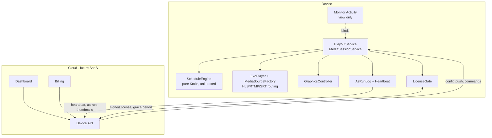

# Telefyna: Industry-Readiness Audit

**Date:** 2026-10-29
**Scope:** `main` @ `c4ea8e8` (v3.0.0), plus a review of `feature/intelligent-gap-fillers` (`a621026`, `e1b6d9d`)
**Baseline:** `./gradlew testDebugUnitTest` passes. The unit tests cover models and utils only. The playout engine (`Monitor.kt`) has no tests.

The goal is a 24/7 unattended playout that meets industry standards and can later be sold as a generic, subscription-based product. Findings are ranked by broadcast impact:

| Severity | Meaning |
|---|---|
| **P0** | Can take the channel off air (black screen, silence, or a crash loop) |
| **P1** | Wrong content on air, or poor broadcast quality |
| **P2** | Security, fleet operations, or remote management |
| **P3** | Code health and tech debt that block the items above |

---

## 1. Why the box "goes off after some time"

Keeping the screen awake fixed only one cause. The code has several other ways to go off air on its own:

1. **Midnight maintenance race:** a crash or restart, and possibly a hang (P0-1).
2. ~~The watchdog can't revive a dead process on Android 10+~~: **not reproduced** on Android 12; still unverified on Android 14+ (P0-2).
3. **Activity recreation:** an HDMI, display, or Bluetooth change destroys the player (P0-3).
4. **Audio focus or "noisy" events pause playout:** nothing resumes it for up to 30 s, and then the slot restarts (P0-4).
5. **Error paths leave the player IDLE:** black until the watchdog fires (P0-5).
6. **The watchdog stops rescheduling itself:** after `reboot.txt` on unrooted boxes, or when the config failed to load (P0-6).

---

## 2. P0: Off-air risks

### P0-1 Midnight maintenance leaves the engine with an empty playlist table
- **Where:** [Maintenance.kt:42-62](../app/src/main/java/org/avventomedia/app/telefyna/listen/Maintenance.kt#L42-L62), [Monitor.kt:428-438](../app/src/main/java/org/avventomedia/app/telefyna/Monitor.kt#L428-L438), [Utils.kt:117-133](../app/src/main/java/org/avventomedia/app/telefyna/Utils.kt#L117-L133)
- **What happens:** `initialise()` sets `playlistByIndex = mutableListOf()` on the main thread. `schedule()` only refills it after a background thread has run `Metrics.retrieve()`, and that calls `https://ipinfo.io/json` through `URL.openStream()` with **no connect or read timeout**. Video keeps playing in the meantime. The next `onMediaItemTransition` → `cacheNowPlaying` → `getPlaylistIndex()` (or `STATE_ENDED` → `playlistByIndex[it]`, or the KeepOnAir `switchNow`) then throws `IndexOutOfBoundsException` → uncaught handler → app restart → maintenance runs again. When the network is half up, `readUrl` can block forever and the schedule never loads.
- **Fix:** Build the new playlist table off to the side and swap it in atomically on the main thread. Never clear the live one first. Move metrics out of the scheduling critical path, and give every network call a 5–10 s timeout.

### P0-2 Watchdog relaunch on Android 10+ (downgraded: not reproduced on API 31)
- **Where:** [KeepOnAirReceiver.kt:29-35](../app/src/main/java/org/avventomedia/app/telefyna/listen/KeepOnAirReceiver.kt#L29-L35), [PlaylistScheduler.kt:29-35](../app/src/main/java/org/avventomedia/app/telefyna/listen/PlaylistScheduler.kt#L29-L35), [MaintenanceReceiver.kt:23-29](../app/src/main/java/org/avventomedia/app/telefyna/listen/MaintenanceReceiver.kt#L23-L29), [AutoStart.kt:16-23](../app/src/main/java/org/avventomedia/app/telefyna/listen/AutoStart.kt#L16-L23)
- **Original concern:** Android 10+ blocks background activity starts, so the receivers' `context.startActivity()` relaunch would be silently refused.
- **Verified 2026-10-29** on the Google TV emulator (API 31): `am crash` → the system restarts the `START_STICKY` `TelefynaForegroundService` → the KeepOnAir alarm → `ActivityTaskManager: START ... Monitor from uid <app>` → Monitor resumed. **The relaunch works.** The running foreground service keeps the app eligible to start activities.
- **Still to verify:** Android 14+ (stricter background-launch rules), and boot autostart on real boxes. If either fails there, the fix is running Telefyna as the HOME launcher / Device Owner kiosk, or granting `SYSTEM_ALERT_WINDOW`.

### P0-3 Configuration changes destroy and rebuild the player
- **Where:** [AndroidManifest.xml:30](../app/src/main/AndroidManifest.xml#L30), [Monitor.kt:1067-1089](../app/src/main/java/org/avventomedia/app/telefyna/Monitor.kt#L1067-L1089)
- **What happens:** Only `orientation|keyboardHidden` is declared. On a TV box, the common events are HDMI re-handshake, TV power-cycle or CEC (`screenSize|screenLayout|smallestScreenSize|density`), a Bluetooth remote or keyboard connecting (`keyboard|navigation`), and night mode (`uiMode`). Any of them recreates the Activity: `onDestroy` releases the player and the new instance restarts the slot from scratch. This likely explains the README's "connecting Bluetooth plays fillers / only audio" item.
- **Fix:** `android:configChanges="orientation|screenSize|screenLayout|smallestScreenSize|density|keyboard|keyboardHidden|navigation|uiMode|fontScale|layoutDirection|colorMode"`. Long term, keep the player in a Service so the Activity's lifetime doesn't matter.

### P0-4 The player pauses itself on audio focus or "noisy" events
- **Where:** [Monitor.kt:461-471](../app/src/main/java/org/avventomedia/app/telefyna/Monitor.kt#L461-L471)
- **What happens:** `setAudioAttributes(attrs, handleAudioFocus = true)` and `setHandleAudioBecomingNoisy(true)` are phone media-player behaviour. Any other app that takes audio focus (RustDesk, a system sound, a TV-launcher preview), or an audio route change such as a Bluetooth disconnect, pauses playout. The KeepOnAir check notices up to `wait` (30 s) later and calls `switchNow`, which restarts the slot.
- **Fix:** For a broadcast appliance, use `handleAudioFocus = false` and `setHandleAudioBecomingNoisy(false)`. Also add `setWakeMode(C.WAKE_MODE_NETWORK)`: the manifest declares `WAKE_LOCK`, but no wake or Wi-Fi lock is ever taken, and Wi-Fi power-save causes stream drops.

### P0-5 Error handling leaves the player IDLE
- **Where:** [Monitor.kt:940-1031](../app/src/main/java/org/avventomedia/app/telefyna/Monitor.kt#L940-L1031)
- **What happens:**
  - After `onPlayerError` the player is in `STATE_IDLE`. `handlePlaybackCrash` calls `player.seekTo(next, 0)` (lines 1010 and 1024) **without `prepare()`**, so the "skip corrupted file" path leaves the screen black until the watchdog fires.
  - **`BehindLiveWindowException`**, a routine HLS hiccup, has no special handling. It falls into `else` → `handlePlaybackCrash` → **switches the live channel to fillers**. (The README lists it as solved; on `main` it isn't.)
  - The errors are classified by `error.cause?.cause`. Many network failures (for example `HttpDataSourceException`) sit at `error.cause`, so they miss the network branch.
  - Line 988: `player?.isPlaying!!` throws an NPE inside the error handler when `player` is null.
  - When the network branch decides not to switch (already on fillers, or fillers are empty), nothing retries.
- **Fix:** Classify errors by `error.errorCode` (`ERROR_CODE_BEHIND_LIVE_WINDOW` → `seekToDefaultPosition(); prepare()`; `ERROR_CODE_IO_*` → retry with backoff, then fall back; `ERROR_CODE_DECODING_*` / `PARSING_*` → skip the item and `prepare()`). Always end in a playing state or a fallback slate.

### P0-6 The watchdog can stop rescheduling itself
- **Where:** [Monitor.kt:1650-1687](../app/src/main/java/org/avventomedia/app/telefyna/Monitor.kt#L1650-L1687), [Monitor.kt:1598-1604](../app/src/main/java/org/avventomedia/app/telefyna/Monitor.kt#L1598-L1604)
- **What happens:**
  - `reboot.txt`: `su -c reboot` fails on unrooted boxes and the IOException is swallowed. That branch never calls `scheduleKeepOnAir()`, so the stuck detector is gone until the next scheduled playlist.
  - The internet-restored branch doesn't reschedule either. It relies on `switchNow`, which skips rescheduling when it takes the "online but no internet" path.
  - `switchNow(nowPlayingIndex!!)` throws an NPE when the config never loaded.
  - The `onDestroy` cancel builds an implicit `Intent(KEEP_ON_AIR_ACTION)`, which doesn't match the explicit-component intent that was scheduled, so the cancel is a no-op.
- **Fix:** Reschedule the heartbeat first, in a `try/finally`, on every path. Use `setAlarmClock()` or `setExactAndAllowWhileIdle()` everywhere ([Maintenance.kt:84](../app/src/main/java/org/avventomedia/app/telefyna/listen/Maintenance.kt#L84) uses a plain `setExact`, which Doze can defer). Check `canScheduleExactAlarms()` on API 31+.

### P0-7 A bad or missing config means a crash loop or a black screen with no alert
- **Where:** [Monitor.kt:431-437](../app/src/main/java/org/avventomedia/app/telefyna/Monitor.kt#L431-L437), [Playlist.kt:59](../app/src/main/java/org/avventomedia/app/telefyna/modal/Playlist.kt#L59), [Playlist.kt:79](../app/src/main/java/org/avventomedia/app/telefyna/modal/Playlist.kt#L79)
- **What happens:** `initialise()` catches only `IOException`. A malformed JSON file (`JsonSyntaxException`) or a start time like `"8:30 AM"` (`NumberFormatException` in `isStarted()` / `getStartTime()`) crashes on the main thread, the app restarts, reads the same file, and crashes again. A missing config leaves `configuration == null`: nothing plays, no watchdog runs, and no alert goes out.
- **Fix:** Validate the config against a schema on load, and keep a **last-known-good** copy in app-private storage to fall back to. Ship a built-in **fallback slate** ("We'll be right back" plus the station ID) that plays whenever nothing else can. Add crash-loop protection: after N crashes in M minutes, boot in safe mode (slate and fillers only, plus an alert). The OOM marker is written today but never read.

### P0-8 The box's clock is trusted blindly
- **Where:** [DateChange.kt:11-14](../app/src/main/java/org/avventomedia/app/telefyna/listen/DateChange.kt#L11-L14), [AutoStart.kt](../app/src/main/java/org/avventomedia/app/telefyna/listen/AutoStart.kt), [BootReceiver.kt:13](../app/src/main/java/org/avventomedia/app/telefyna/listen/BootReceiver.kt#L13)
- **What happens:** Many TV boxes have no RTC battery and boot with a stale date until NTP syncs. Telefyna starts about 10 s after boot, schedules every alarm for the wrong day and time, and when NTP corrects the clock the `TIME_SET` / `TIMEZONE_CHANGED` receiver only logs it. `BootReceiver` is a no-op (`Monitor.instance` is always null at boot).
- **Fix:** On `TIME_SET` or `TIMEZONE_CHANGED`, re-run maintenance. At boot, wait until the clock is plausible (for example year ≥ build year, or an NTP or HTTP `Date` check) before scheduling. Remove `BootReceiver` or merge it into `AutoStart`.

### P0-9 Main-thread blocking during playout
- **Where:** [Utils.kt:22-57](../app/src/main/java/org/avventomedia/app/telefyna/Utils.kt#L22-L57), [Monitor.kt:776-851](../app/src/main/java/org/avventomedia/app/telefyna/Monitor.kt#L776-L851), [Logger.kt:37-86](../app/src/main/java/org/avventomedia/app/telefyna/audit/Logger.kt#L37-L86), [Monitor.kt:316](../app/src/main/java/org/avventomedia/app/telefyna/Monitor.kt#L316)
- **What happens:** `StrictMode.permitAll()` hides these:
  - `internetConnected()` opens a socket to 8.8.8.8 with a 1.5 s timeout on the main thread, inside `switchNow`, KeepOnAir, and **every** ADMIN or BROADCAST log line when alerts are on. Offline, every log line blocks for 1.5 s, which drops frames and risks an ANR.
  - `seekImmediateNonCompletedSlot` runs `MediaMetadataRetriever` over every file in the folder on the main thread at slot start. The cache is in memory only, so it starts cold after every restart.
  - Every log line is a synchronous file append on the main thread.
- **Fix:** Track connectivity with a `ConnectivityManager.NetworkCallback` (event-driven, no polling) and keep any probe off the main thread. Keep a persistent duration index built in the background at ingest or maintenance time. Write logs through a single background writer.

---

## 3. P1: Wrong content and broadcast quality

| ID | Where | What happens | Fix |
|---|---|---|---|
| P1-1 | [Playlist.kt:89-102](../app/src/main/java/org/avventomedia/app/telefyna/modal/Playlist.kt#L89-L102) | `scheduledToday()` returns `true` when `days` is empty, **even when `dates` is set**. A date-only special (Christmas, a live event) airs **every day**. `Schedule.scheduledToday()` gets this right but is never called. | Use the `Schedule` logic. Add a unit test for the dates-only case. |
| P1-2 | [Maintenance.kt:160-180](../app/src/main/java/org/avventomedia/app/telefyna/listen/Maintenance.kt#L160-L180) | The custom RTMP and **SRT `MediaSource`s are built and thrown away**: only `.mediaItem` is kept, and the player uses its default factory. RTMP works by luck (`DefaultDataSource` finds the RTMP extension). **SRT goes to the HTTP data source and fails**, so SRT has never really worked. | Give the player a custom `MediaSource.Factory` that routes by URI scheme (`srt` → `SrtDataSourceFactory` + TS extractor). |
| P1-3 | [network_security_config.xml](../app/src/main/res/xml/network_security_config.xml) | With `targetSdk 35`, cleartext is off by default. **Plain `http://` HLS or IPTV streams are refused**, and those are very common on LANs and with encoders. | `<base-config cleartextTrafficPermitted="true">`, or allow-list specific domains. |
| P1-4 | [Monitor.kt:883-888](../app/src/main/java/org/avventomedia/app/telefyna/Monitor.kt#L883-L888) | Every `STATE_BUFFERING` on ONLINE calls `seekTo(contentDuration)`. For live streams the duration is unset or the window length, so each buffer event seeks again, and progressive RTMP/SRT reconnects. The result is stutter or a reconnect loop on weak links. | Remove the hack. Set `MediaItem.LiveConfiguration` (target offset), tune `DefaultLoadControl`, and handle behind-live-window by error code (P0-5). |
| P1-5 | [Monitor.kt:1291-1338](../app/src/main/java/org/avventomedia/app/telefyna/Monitor.kt#L1291-L1338) | Ticker and lower-third coroutines (`lifecycleScope.launch { delay(); show() }`) are **never cancelled on a playlist switch**, so graphics meant for the previous programme appear during the next one. That is an on-air compliance error. | Keep a `Job` for the graphics and cancel it at the start of every switch. Base the timing on player position, not wall-clock `delay`. |
| P1-6 | [Maintenance.kt:242-251](../app/src/main/java/org/avventomedia/app/telefyna/listen/Maintenance.kt#L242-L251) | At 00:00, maintenance only knows about today's slots. A show running from 23:00 to 01:00 is **cut to the first default at midnight**. Picking the "current slot" also sorts `"HH:mm"` as strings, which breaks when times aren't zero-padded. | Compute the active slot across the midnight boundary (yesterday's last slot carries over). Parse times to minutes before sorting. |
| P1-7 | [Monitor.kt:170-207](../app/src/main/java/org/avventomedia/app/telefyna/Monitor.kt#L170-L207) | The resume position is saved only on item transitions and errors. After a power cut, `LOCAL_RESUMING` restarts the programme from the beginning. The resume pointer is an **index**, and "modified" is the top-level folder's mtime (subfolders aren't tracked), so adding or removing a file resumes the wrong episode (README backlog item). | Persist `{mediaId, position}` every 10–15 s. Resume by file identity, not index. |
| P1-8 | [Monitor.kt:463](../app/src/main/java/org/avventomedia/app/telefyna/Monitor.kt#L463), [monitor.xml](../app/src/main/res/layout/monitor.xml) | No **loudness normalisation**: files mastered at different levels jump in volume between items. On `main`, the `PlayerView` is `wrap_content` + `texture_view`. `TextureView` costs GPU composition on low-end SoCs (dropped frames at 1080p60) and blocks HDR and tunnelled playback. | Add an EBU R128 / ATSC A/85 normalisation step (pre-computed gain per file at ingest, applied with an `AudioProcessor`). Use `surface_view` unless the cross-fade needs a texture. Take `match_parent` from the feature branch. |
| P1-9 | [Utils.kt:151-158](../app/src/main/java/org/avventomedia/app/telefyna/Utils.kt#L151-L158) | Images (`png/jpg/gif/webp`) are accepted as programmes, but no `setImageDurationMs` is set, so behaviour depends on the Media3 version (needs checking on a device). Common broadcast formats are rejected: `mp3`, `m4a`, `aac`, `mpg`, `m2ts`, `mxf`, `m4v`. The duration calculation treats images as 0 ms. | Set the image duration from config, widen the format list, and probe files at ingest. |
| P1-10 | [Monitor.kt:1402-1428](../app/src/main/java/org/avventomedia/app/telefyna/Monitor.kt#L1402-L1428) | Lower thirds play in a `VideoView` (a second `MediaPlayer` decoder). Low-end boxes often have one or two hardware decoders, so the lower third fails or starves the main video. | Use animated WebP or PNG sequences with alpha, or a single compositing pipeline. |
| P1-11 | [Monitor.kt:1250-1255](../app/src/main/java/org/avventomedia/app/telefyna/Monitor.kt#L1250-L1255), [monitor.xml](../app/src/main/res/layout/monitor.xml) | The overlay is the `PlayerView` **controller**, so remote media keys (play/pause, FF, next) may reach the player and change the broadcast. Needs checking on a device. | Consume all media and D-pad keys in `dispatchKeyEvent`. Allow only a secret admin key sequence. |
| P1-12 | [Monitor.kt:338-356](../app/src/main/java/org/avventomedia/app/telefyna/Monitor.kt#L338-L356) | External storage detection relies on path splitting. If `/mnt/usb` exists but is empty it silently falls back to internal storage. With both SD and USB, which one wins depends on the order the OS lists them. | Let the config name a volume by label or UUID through `StorageManager`. Log the path that was resolved. |

---

## 4. P2: Security, fleet, and remote management

| ID | Where | Issue | Fix |
|---|---|---|---|
| P2-1 | [AndroidManifest.xml:40](../app/src/main/AndroidManifest.xml#L40) | `PlaylistScheduler` is `exported="true"` with no permission, so **any app on the box can switch the channel**. | `exported="false"`. Alarms with explicit intents don't need export. Do the same for `DateChange`, `BootReceiver`, and `AutoStart`: system broadcasts still arrive. |
| P2-2 | [AndroidManifest.xml:37](../app/src/main/AndroidManifest.xml#L37) | No `LEANBACK_LAUNCHER` category, so the app **doesn't appear in the Android TV / Google TV launcher**. The banner is the square launcher icon (it should be 320×180). | Add the category and a proper banner. |
| P2-3 | [Monitor.kt:406-422](../app/src/main/java/org/avventomedia/app/telefyna/Monitor.kt#L406-L422) | On Android 11+, `telefynaAudit` (logs **and** the `init.txt` / `restart.txt` / `reboot.txt` control files) lives in `Android/data/<pkg>/files/`. FTP, Syncthing, and file managers can't reach it, so the README's remote-control workflow doesn't work there. It's also wiped on uninstall. | The app already has `MANAGE_EXTERNAL_STORAGE`: put control files in `/telefyna/control/`. Better, replace file-drop control with an authenticated remote API (§7). |
| P2-4 | [Logger.kt:76-86](../app/src/main/java/org/avventomedia/app/telefyna/audit/Logger.kt#L76-L86), [Mail.kt:126-163](../app/src/main/java/org/avventomedia/app/telefyna/listen/mail/Mail.kt#L126-L163) | **Email storm:** every ADMIN or BROADCAST event (each item change, **each key press**, each resume cache) is a separate SMTP send through the deprecated `AsyncTask`. Gmail rate-limits or blocks the account. ADMIN mail goes to **every** subscriber regardless of `eventCategory`. The `Draft` object is shared across subscribers, so **BCC lists build up and leak addresses** between subscriber groups. | Send a digest (for example every 15 min or daily) plus immediate alerts only for real incidents (off-air, crash, fallback). Build a new draft per subscriber and apply the category filter. Replace SMTP with an HTTPS webhook or the dashboard (§7). |
| P2-5 | [Logger.kt:106-116](../app/src/main/java/org/avventomedia/app/telefyna/audit/Logger.kt#L106-L116), [Mail.kt:91-107](../app/src/main/java/org/avventomedia/app/telefyna/listen/mail/Mail.kt#L91-L107) | `getAuditsForNDays` calls `({ ... }).toString()` on a **lambda**, so the "path" is `Function0<…>` and **audit logs are never attached**. If attachments are configured and the event isn't MAINTENANCE, the message gets no body and the send fails. | Call the expression rather than wrapping it in a lambda. Always set content. |
| P2-6 | [Mail.kt:40-50](../app/src/main/java/org/avventomedia/app/telefyna/listen/mail/Mail.kt#L40-L50), [Mailer.kt](../app/src/main/java/org/avventomedia/app/telefyna/modal/Mailer.kt) | The SMTP password sits in `config.json` on shared storage, hidden behind repeated base64 with a key hard-coded in the source, which is obfuscation, not encryption. `java.util.Base64` crashes on API < 26 while `minSdk = 21`. | Keep secrets out of the media config: provision them into the Android Keystore or app-private storage, or remove SMTP. Raise `minSdk` to 26, or use `android.util.Base64`. |
| P2-7 | [TelefynaUnCaughtExceptionHandler.kt:29-42](../app/src/main/java/org/avventomedia/app/telefyna/listen/TelefynaUnCaughtExceptionHandler.kt#L29-L42) | Replaces the default handler without chaining it. If `Monitor.instance` is null the process is left half-dead (no crash, no restart), and the OS never records `REASON_CRASH` for forensics. | Log, then delegate to the previous handler. Let the OS-level relaunch (HOME / Device Owner) bring the app back. |
| P2-8 | [create_issues.py:123-125](../.github/scripts/create_issues.py#L123-L125) | The README-to-Issues sync turns **off TLS verification** while sending the GitHub token. It reads only `per_page=100` existing issues, so after 100 issues it creates duplicates. | Use the default SSL context. Paginate. |
| P2-9 | Whole app | No remote visibility: no heartbeat, no now-playing feed, no thumbnail, no crash reporting, no OTA. An operator only learns about an outage when a viewer calls. | See §7. This is also the foundation of the paid product. |

---

## 5. P3: Code health

- **`Monitor` is a 1,700-line god object** that is the Activity, scheduler, player controller, graphics engine, file-path resolver, and permission manager at once. Everything reaches it through the static `Monitor.instance`, so the core logic can't be unit-tested and dies with the Activity.
- **The main logic relies on `!!` and index access** (`playlistByIndex[i]`, `programItems[at]`). Any desync crashes the app.
- **Unbounded audit logs:** one file per day, never pruned or rotated. A box running for months fills its storage. `Logger.datetimeFormat` is a shared `SimpleDateFormat` used from several threads, which isn't thread-safe.
- **`@RequiresApi(O)` is spread across lifecycle methods while `minSdk = 21`.** It suppresses lint without protecting at runtime. Decide on a real `minSdk` (26 is realistic for TV boxes; check the 7.1 / API 25 share of your fleet first).
- **Dead or misleading code:** `previousPlayer` is never assigned; `GlobalScope` and `VideoView` are imported, as is the `PlayerNotificationManager` listener with no manager; `isSupportedImageAudioOrVideo` is unused; the `Program` model is unused; `Receivers.emails` says "separated by #" but the code splits on a comma; and `Config.kt` hard-codes "3ABN TV".
- **Fade-in:** a new `ValueAnimator` starts on every switch and the previous one is never cancelled, so quick switches fight over the volume.
- **CI:** runs JVM unit tests only. No lint, no `assembleRelease` (R8 rules for Gson models are minimal), and no instrumented smoke test.

---

## 6. Review of `feature/intelligent-gap-fillers` (not yet merged)

Gapless pre-appending of the filler playlist and the disk-cached duration index are good ideas, but the branch shouldn't be merged as is:

1. **Crash on every gapless transition:** `Logger.log(AuditLog.Event.PLAYLIST_SWITCH, "Pre-appended…")` and `"Gapless transition complete…"` pass **1** argument to a format with **3** `%s` → `MissingFormatArgumentException` → the uncaught handler restarts the app. Use a dedicated event with a single `%s`.
2. `DurationCacheManager` is a plain `mutableMapOf` read and written from the maintenance thread and the main thread (not thread-safe). It rewrites the whole JSON file **on every cache miss, on the main thread**, and keys by path only, so a file replaced under the same name keeps its stale duration. Key by `path + size + mtime`, use a `ConcurrentHashMap`, and save in batches off the main thread.
3. `intelligentSort` defaults to `true`, which silently changes every existing `LOCAL_RANDOMIZED` playlist. It should default to `false`, or be opt-in through the config tool.
4. "Bin-packing" is really a long-first or short-last partition. It doesn't fit items against the time left before the next slot. Fine as a first step, but name it accurately.
5. Ordering race: outro bumpers are added asynchronously ([Monitor.kt:672-697](../app/src/main/java/org/avventomedia/app/telefyna/Monitor.kt#L672-L697)) **without the playlist tag**. If the pre-append runs first, bumpers land after the filler items and are treated as part of the filler.
6. Good fixes worth keeping: `PlayerView` `match_parent`, and the `hasNextMediaItem()` guard in `STATE_ENDED`.

---

## 7. Gaps against industry-standard playout

Professional playout systems (and signage players such as BrightSign) treat these as standard features:

| Area | Industry expectation | Telefyna today |
|---|---|---|
| Always-on | Kiosk / Device Owner, HOME launcher, hardware watchdog, safe-mode boot | Activity relaunch (blocked on 10+) |
| Fallback | Built-in emergency slate, last-known-good config, never black | Black screen if config or fillers are missing |
| Timing | Hard vs soft starts (cut now vs wait for the item to end), join-in-progress, second-level accuracy, trusted clock (NTP) | Minute resolution, hard cut only, clock not checked |
| As-run log | Structured log of every item (actual start, end, duration, source, interruptions); the basis for ad billing and regulatory affidavits | Free-text audit log |
| Monitoring | Heartbeat, now-playing, confidence thumbnail, silence and black-frame detection, alerting | Email per event |
| Audio | Loudness normalisation (EBU R128 / ATSC A/85), silence detection | None |
| Accessibility | Sidecar captions (SRT / WebVTT / CEA-608) | None |
| Ingest | Pre-air media validation (probe codec, duration, corruption) and a pre-computed media index | Discovered at air time |
| EPG | XMLTV / JSON programme guide generated from the schedule | None |
| Config | Versioned schema, validation, staged rollout, remote push | `config.json` dropped over FTP, reloaded by file flag |
| Fleet | Device registration, remote config, OTA updates, remote reboot | Per-box manual |

### Target architecture

- Pull `ScheduleEngine` out as a pure function: `(config, now) → what should be on air, from where, until when`. Then all of the scheduling bugs above can be covered by JVM unit tests.
- The player lives in the Service. The Activity only binds a `PlayerView` to it, so recreating the Activity no longer interrupts output.

---

## 8. Path to a commercial, subscription product

To sell Telefyna as a generic product, the **device** needs these first:

1. **De-branding / white-label:** remove the hard-coded station and organisation references, make the notification text, slate, and logo come from config, and support per-tenant branding.
2. **Device identity:** a stable device ID plus registration (a pairing code shown on screen → claimed in the dashboard).
3. **Remote API instead of file drops:** an authenticated HTTPS channel for config push, commands (reload, restart, reboot, screenshot), and telemetry upload. Polling, FCM, or WebSocket all work.
4. **LicenseGate (payments and timeouts):** a signed licence token (JWT or Ed25519) with `plan`, `features`, and `expiresAt`, refreshed with each heartbeat.
   - **Never go black on expiry.** Broadcast customers will churn and complain loudly. Instead, step down gradually: a reminder overlay, then an "unlicensed" watermark, then fillers-only mode once a grace period (for example 7–14 days offline or overdue) runs out.
   - Check the licence offline against the cached token, so a short internet outage never triggers enforcement.
   - Gate features by plan: number of channels or devices, online streams, graphics, lower thirds, remote management, as-run export.
5. **Telemetry for the dashboard:** heartbeat (up/down), now-playing, as-run log, device metrics (CPU temp, RAM, storage, uptime), errors and crash reasons, confidence thumbnails.

The **cloud** side (a separate project): a multi-tenant dashboard (fleet status, schedule editor replacing the current web config tool, alerts, as-run reports), billing (Stripe / Paddle subscriptions, plus local mobile money such as M-Pesa or MTN MoMo if East Africa is a target market), and licence issuing tied to subscription state.

---

## 9. Suggested order of work

1. **Stabilise (1–2 weeks):** P0-1, P0-3 … P0-9 (P0-2 only if it reproduces on Android 14+), P1-1, P1-2, P1-3, P1-5, P2-1, P2-2. Most are small, contained changes.
2. **Fix the feature branch** (§6), then merge it.
3. **Re-architect:** extract `ScheduleEngine` with tests, move the player into `PlayoutService`, and add structured as-run logging and the fallback slate.
4. **Broadcast quality:** loudness normalisation, resume by file identity, ingest validation, captions, EPG export.
5. **Commercial foundation:** de-branding, device identity, remote API, heartbeat, LicenseGate. Then build the cloud dashboard and billing.
